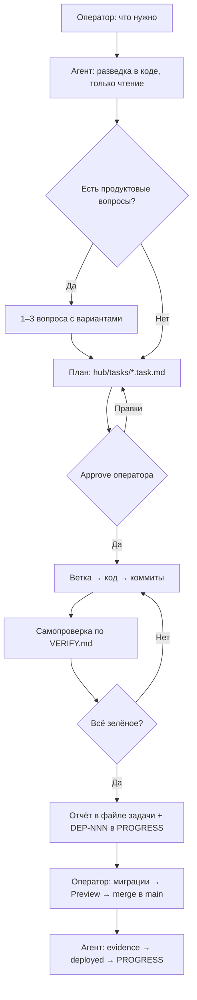

# Пайплайн: роли, цикл, ID, сессии

Адаптация Control Hub Kit под один репозиторий и одного агента (D-001).

---

## 1. Роли

| Кто | Делает | Не делает |
|---|---|---|
| **Оператор** (Василий) | Задаёт приоритеты, принимает продуктовые решения, даёт approve плана и «go» на деплой. Мержит и пушит в `main`, применяет SQL в Supabase, меняет env на Vercel и настройки ЮKassa, проходит финальный смоук | — |
| **Агент** (Claude Code) | Разведка, план, код в ветке задачи, самопроверка по `VERIFY.md`, отчёт, блок деплоя, проверка evidence, журнал | Не трогает прод, `main`, Supabase SQL и env. Не расширяет скоуп |
| **Память** (`hub/`) | Хранит контекст между чатами | — |

Если позже появится второй агент (Cursor, подрядчик), вернуть из kit трёхуровневую схему:
исполнитель по промпту, агент проверяет как надзор.

## 2. Размер задачи

| Задача | Файл задачи | Approve плана | Ветка |
|---|---|---|---|
| **Мелкая**: текст, стили, фикс в 1–2 файлах без денег, auth и БД | не нужен, план одной фразой в чате | не нужен, если оператор сразу сказал «сделай» | можно `fix/<суть>` |
| **Обычная**: фича или фикс в нескольких файлах | `hub/tasks/<дата>-<ID>.task.md` | **да** | `feat/<id>` / `fix/<id>` |
| **Рискованная**: деньги, ЮKassa, цены, RLS, auth и сессии, миграции, договор, рефактор на 5+ файлов | обязательно, со стоп-сигналами и крайними случаями | **да** | обязательно + Preview gate |

## 3. Цикл задачи



## 4. Правила

1. **План до кода.** Для обычной и рискованной задачи код начинается только после approve.
   Лишний скоуп ловится на плане, а не на ревью.
2. **Скоуп задаёт план.** Всё из «НЕ трогать» остаётся нетронутым. Замеченное по дороге идёт
   в «Следующее», а не в этот diff.
3. **Стоп-сигналы.** В плане заранее перечислено, какие решения недопустимы. Если реализация
   к ним подводит, работа останавливается и выносится вопрос оператору.
4. **Не принимать на слово, даже себя.** Typecheck, build, diff, curl и браузер запускаются
   на деле, в отчёт идёт вывод, а не пересказ.
5. **Сначала схема, потом код.** Если нужна миграция, она идёт отдельным файлом
   `scripts/NNN_*.sql` и применяется до merge (D-002).
6. **Деньги считает сервер.** Любая сумма, статус оплаты или скидка, пришедшие из браузера,
   используются только как подсказка UI.
7. **В журнал только проверенное.** Сначала verify, потом `PROGRESS.md`.
8. **Решения оператора записываются** в файл задачи и, если они долгоживущие, в `DECISIONS.md`.
9. **Сессия заканчивается записью в журнал.** Это мост к следующему чату.

## 5. Идентификаторы и файлы

| Что | Формат | Пример | Кто выдаёт |
|---|---|---|---|
| Задача | `<ОБЛАСТЬ>-<СУТЬ>` капсом | `SEC-BOOKING-PRICE`, `ADMIN-CSV-EXPORT` | агент |
| Фикс после самопроверки или замечаний | `-FIX`, `-FIX2` | `SEC-BOOKING-PRICE-FIX` | агент |
| Деплой | `DEP-NNN` | `DEP-001` | `bash hub/scripts/next-id.sh DEP` |
| Решение | `D-NNN` | `D-003` | `bash hub/scripts/next-id.sh D` |
| Инцидент | `INC-NNN` или `INC-<СУТЬ>` | `INC-LOGOUT` | `bash hub/scripts/next-id.sh INC` |

Области: `SEC`, `BOOKING`, `PAY`, `AUTH`, `DASH`, `ADMIN`, `LANDING`, `LEGAL`, `DB`, `TOOLING`, `CONTENT`, `CHORE`.

Файлы в `hub/tasks/` (сортируются по дате):

```
hub/tasks/2026-10-29-SEC-BOOKING-PRICE.task.md     план, решения, отчёт о проверке
hub/tasks/2026-11-02-INC-LOGOUT.incident.md        разбор инцидента
```

Создание: `bash hub/scripts/new-task.sh <task|incident> <ID>`.

## 6. Статусы

| Статус | Значение |
|---|---|
| `plan` | файл задачи написан, ждёт approve |
| `approved` | оператор одобрил план |
| `in progress` | агент пишет код |
| `verified` | самопроверка пройдена, отчёт в файле задачи, строка DEP в PROGRESS |
| `HOLD` | остановлено решением оператора или ждёт внешнего события (указать какого) |
| `preview` | на Preview, идёт смоук |
| **`deployed`** | в `main`, Ready на Vercel, есть evidence |
| `rolled back` | откачено, заведён инцидент |

## 7. Сессии

### Старт (`/session-start`)

Прочитать `PROJECT.md`, затем в `PROGRESS.md` разделы «Активно», «Следующее», «Блокеры»,
«Ожидает деплоя», потом файлы активных задач в `hub/tasks/`, потом `git status`.

### Конец (`/session-end`; контекст заполнен больше чем на 70%, фаза закрыта или конец дня)

- [ ] «Активно», «Следующее», «Блокеры» соответствуют действительности
- [ ] В «Ожидает деплоя» есть строки для всех проверенных задач
- [ ] В логе сессий есть строка с датой, ID и результатами проверок
- [ ] Новые решения записаны в `DECISIONS.md`
- [ ] Изменения API отражены в `API_CONTRACT.md`
- [ ] Изменения `hub/` закоммичены (только свои файлы, `git status` проверен) после «go»

## 8. Типовые ошибки

| Ошибка | Как правильно |
|---|---|
| Начал писать код, пока оператор читает план | Ждать approve |
| Push в `main`, «чтобы посмотреть на Vercel» | Push ветки → Preview |
| `PROGRESS.md` обновили до проверки | Сначала verify, потом журнал |
| Новый чат начали без чтения `PROGRESS.md` | `/session-start` |
| «Заодно отрефакторил» | Отдельная строка в «Следующее» |
| Цену или статус взяли из тела запроса | Пересчитать на сервере из `boxes` / `payments` |
| Правка RLS в коде без SQL-миграции | Новый `scripts/NNN_*.sql`, оператор применяет |
| `deployed` по словам «вроде всё ок» | SHA Ready-деплоя, 200, смоук |
| Поменяли `lib/supabase/client.ts` или `proxy.ts` «для чистоты» | Только с задачей и сценарием логина в отчёте: см. `LESSONS.md` |
